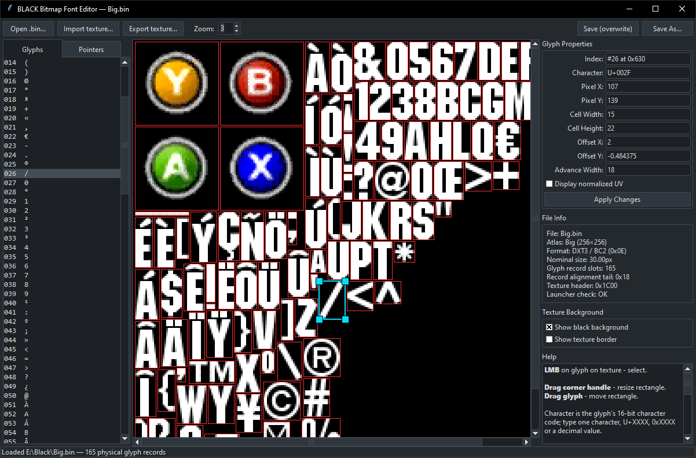

[badge-en]: https://img.shields.io/badge/lang-English%20%F0%9F%87%AC%F0%9F%87%A7-white
[badge-ru]: https://img.shields.io/badge/%D1%8F%D0%B7%D1%8B%D0%BA-%D0%A0%D1%83%D1%81%D1%81%D0%BA%D0%B8%D0%B9%20%F0%9F%87%B7%F0%9F%87%BA-white
[vot-readme-en]: README.md
[vot-readme-ru]: README_RU.md
[![en][badge-en]][vot-readme-en]
[![ru][badge-ru]][vot-readme-ru]

# Black Font Editor

### A visual font editor for Black.

## Files

- `conker_glyph_format.py` — library for reading and writing the font format and managing open-addressed character maps (required by the editor)
- `conker_texture.py` — reads and replaces the texture embedded in the .bin (used by the library and the editor)
- `conker_glyph_editor.py` — the main graphical editor (tkinter)

All files must be located in the same folder.

## Screenshot

<p align>
  
</p>

## Installation (Windows)

### Option 1 — Download the executable

Download the latest `.exe` version from the [Releases](https://github.com/AS97GitHub/Conker-Glyph-Editor/releases) page.

> No `python` installation or additional dependencies are required.

### Option 2 — Run from source

1. Make sure Python 3.8 or later is installed (tkinter is included with the standard Windows Python distribution, so no separate installation is required).
2. Install Pillow:

   ```
   pip install Pillow
   ```

## Running

> ⚠️ On Windows, you can use either `python` or `py` to run the script, depending on your Python installation.

> ⚠️ On Linux you may need to use `python3` instead of `python`.

```bash
python conker_glyph_editor.py
```
