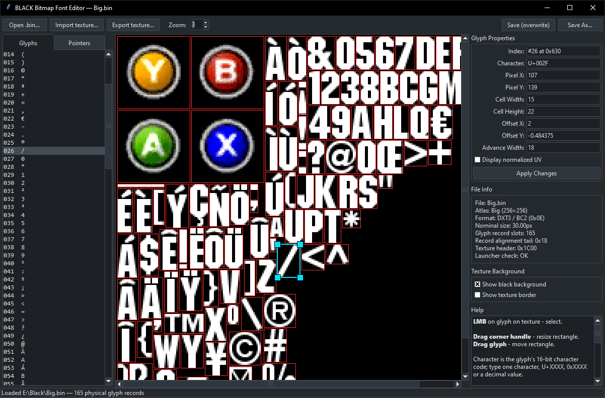

[](README.md)
[](README_RU.md)

# Black Font Editor

Визуальный редактор растровых шрифтов для игры **BLACK** (Xbox). Позволяет просматривать, редактировать метрики глифов и заменять текстуры-атласы в файлах `Big.bin` и `Small.bin` (формат `4.1v`).

## Возможности
* **Визуальное редактирование:** Перемещение и изменение размера прямоугольников глифов прямо на текстуре.
* **Редактирование метрик:** Изменение UV-координат, размеров ячеек, смещений и ширины продвижения (в пикселях или нормализованных float-значениях).
* **Импорт/Экспорт текстур:** Экспорт атласа в PNG или импорт нового из PNG/DDS (автоматическое перекодирование в DXT3/BC2).
* **Безопасное патчинг:** Сохраняет все нераспознанные байты, таблицу указателей (128 записей) и заголовки текстур без изменений.
* **Тёмная тема:** Интерфейс на базе Tkinter с современным тёмным оформлением.


## Файлы
* `black_font_editor.py` — основной графический редактор (GUI на Tkinter).
* `black_font_format.py` — библиотека для чтения/записи формата шрифта `4.1v` и записей глифов.
* `black_texture.py` — кодеки DXT1/3/5 и загрузчик DDS, используемые редактором.

*Все файлы должны находиться в одной папке.*

## Скриншот

<p align>
  
</p>

## Требования
* Python 3.8 или новее (`tkinter` входит в стандартную поставку Python).
* Библиотека [Pillow](https://python-pillow.org/).

## Установка и запуск
Установите необходимую зависимость:
```bash
pip install Pillow
```

Запустите редактор (можно сразу указать путь к файлу шрифта):
```bash
python black_font_editor.py [Big.bin | Small.bin]
```

> ⚠️ В Windows для запуска скрипта можно использовать `python` или `py` — в зависимости от того, как установлен Python.

> ⚠️ В Linux вместо `python` может потребоваться использовать `python3`.
